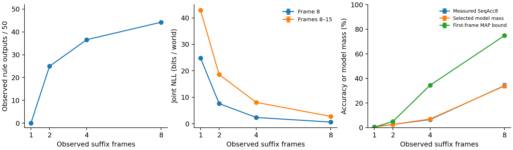

# How much does history resolve the hidden CA rule?

Independent directional 50-slot rule distribution from PR #13, not the
original L3/R0 distribution and not Structance. Use the same three learned
rank-two geometries (M=2048, 20 trainable parameters, frozen here), fresh
seed-40k validation splits, and 32 candidates from the same 128-candidate
random pool. For each world, keep the target frames 8–15 and the starting
state frame 7 fixed, and reveal the last 1, 2, 4 or 8 observed frames.
The new explicit history argument defaults to 8 and rejects a longer
prefix unless the caller explicitly selects its size.

The decoder treats unseen rule outputs as independent fair bits; the
joint NLL of a compatible trajectory under this predictive model is the
number of distinct newly queried rule outputs. For full history (including
the independently sampled initial state) this is the true posterior.
For a truncated suffix, it is a **reset-prior model**, not the true
Bayesian posterior: the first observed state may itself encode earlier
rule-dependent dynamics. Therefore the reported candidate mass and
first-frame MAP upper bound apply to this model only, and are not universal
bounds on measured accuracy for shorter histories. Measured SeqAcc is
evaluated separately against the true future. Parallel BCE assigns a fair
bit to every unknown pixel, while joint NLL charges repeated rule queries
only once. These quantities are not interchangeable.

The scoring function updates known slots using the true future solely
to evaluate joint likelihood. Candidate selection has no access to those
labels. Independent exhaustive tiny-rule enumeration checks the likelihood,
and changing future frames cannot change predictions. The test also
checks that nested histories monotonically increase observed rule coverage
and reduce joint NLL per world. At history 8 the previous PR's baseline
is reproduced exactly, including data hash, SeqAcc and selected mass.

Reproduction:
```sh
PYTHONPATH=scripts python -m pytest -q scripts/tests/test_directional_history.py scripts/tests/test_directional_exact.py scripts/tests/test_directional_search.py scripts/tests/test_directional_metric.py
python scripts/run_directional_history.py --out /tmp/directional-history-fresh.jsonl
python scripts/plot_directional_history.py
```

No training, GPU job, checkpoint or raw trajectory was added; results are
small JSONL records. Error bars are sample SD across three seed datasets.

## Results (6,144 unique validation worlds, 24,576 history-conditioned evaluations)

| Observed frames | Known rule outputs / 50 | First joint NLL (bits) | Eight-frame joint NLL (bits) | Measured SeqAcc8 |
|---:|---:|---:|---:|---:|
| 1 | 0.00 | 24.83 | 42.87 | 0.70% |
| 2 | 24.95 | 7.62 | 18.60 | 2.64% |
| 4 | 36.60 | 2.36 | 8.07 | 6.61% |
| 8 | 44.24 | 0.63 | 2.78 | 34.15% |

History 4 to 8 reduces joint NLL by 5.29 bits and improves measured
closed-loop accuracy by 27.54 percentage points. The final first-frame
MAP mass is 74.82%, whereas selected full-trajectory mass is 33.87%;
a confident first step does not imply a confident eight-step prediction.
The 8-frame result matches the previous fresh split exactly. This
experiment establishes a substantial history-coverage effect for this
decoder, not a general lower bound on Transformer depth.
The JSON field `exact_probability_gap` means the difference between the
model's first-frame upper bound and selected candidate mass, not a
certified suboptimality gap relative to exact trajectory MAP.


