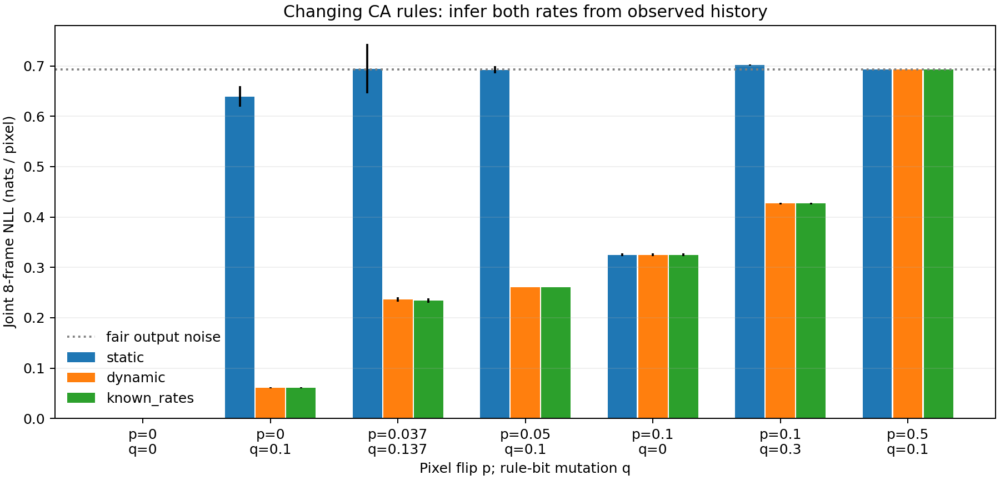

# CA with changing rule tables

Separate stochastic extension, not original L3-SC or R0. Each rule-table
bit changes independently with probability q BETWEEN transitions. Each
output cell independently flips with probability p. The rule bit is shared
by all cells of its class in a given transition; this correlation matters.
The initial table uses the released train/held-out rule halves, but subsequent
mutations can reach any table. No future-dependent self-consistency filter.

The exact two-state forward filter for each learned class marginalizes
over evolving bits. A 12×12 grid maximum-likelihood fit chooses p and q
using only the first eight training frames. We reuse three frozen class
maps learned in earlier work (no analytic rule labels given to inference).
Static comparator fits p on the same grid with q=0. Known-rates comparator
receives true p,q but not latent rule bits. Each setting uses 512 training
and 256 validation trajectories per seed (42/43/44). All initial conditions
and mutations are independently generated per split. True-rate points
include one off-grid case. Scores are exact model joint conditional NLL
per pixel, not independent BCE. Rollout samples a table from the prefix
posterior and then evolves it, using only its own generated states.
Single sampled trajectory exact match is reported in JSONL, not a proper
probabilistic scoring rule.

| True p | True q | Static 8-frame NLL | Changing-rule NLL | Known rates |
|---:|---:|---:|---:|---:|
| 0 | 0 | .000557 | .000557 | .000557 |
| 0 | .10 | .639142 | .061196 | .061196 |
| .037 | .137 | .694484 | .236210 | .234154 |
| .05 | .10 | .692297 | .260575 | .260575 |
| .10 | 0 | .324924 | .324924 | .324924 |
| .10 | .30 | .702141 | .426631 | .426631 |
| .50 | .10 | .693147 | .693147 | .693147 |

All five identifiable on-grid settings recover both true rates for all
three seeds. The off-grid case fits (.05,.15) for all three seeds. At p=.5,
q is unidentifiable: output is a fair coin regardless of the rule table;
floating-point ties may select different q. No claim of recovery there.
Rule mutation alone does NOT have the pixel-flip entropy bound 1-H2(q):
a latent bit is shared across many pixels. A one-class fair-rule case
has one bit of joint uncertainty per transition, versus one bit per pixel
for fair independent output flips (verified by test).



Reproduce in separate output files:
```sh
PYTHONPATH=scripts python scripts/run_mutating_rule.py --maps results/rule_hypotheses/merge_complete.jsonl --out /tmp/ca_mutating.jsonl
PYTHONPATH=scripts python scripts/run_mutating_rule.py --off-grid --maps results/rule_hypotheses/merge_complete.jsonl --out /tmp/ca_mutating_offgrid.jsonl
python scripts/plot_mutating_rule.py
PYTHONPATH=.:scripts python -m pytest -q scripts/tests/test_mutating_rule.py
```

Seven new tests cover static reduction, brute-force latent-state enumeration,
rule versus pixel noise, impossibility, toroidal corner and negative control,
prefix-only fitting, first-frame causality, autonomous sampling and
unidentifiability. 39 relevant tests passed together. 63 evaluation rows
(21 dataset/seed settings × 3 comparators); not 63 neural trainings.
No Structance certification or new R0 results. The 2026-11-25 local queue
doctor reports zero registered releases; no unleased GPUs used.
