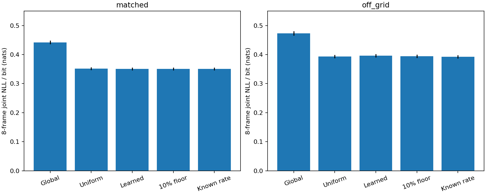

# Trajectory-level heterogeneous noise

The earlier global-noise model assumes every trajectory has the same flip
probability. Here the rate is a persistent latent variable, drawn once per
trajectory. A 51-point grid (0 to .5 in increments of .01) and a learned
population prior integrate over uncertainty in rate and independent rule bits.
We reuse frozen learned rule classes (three seeds), not analytic rule labels.
EM fits the prior on only 1024 training histories per seed; 512 held-out-rule
worlds per seed are used for each evaluation. Rates are never supplied to
learned arms. The known-rate arm is an explicitly privileged comparator.
This is an unfiltered stochastic extension, not the original L3-SC or R0.

Training rate mixture: 0/.03/.10/.25/.50, with probabilities
.15/.15/.35/.20/.15. Matched evaluation uses the same mixture; off-grid
evaluation shifts the rates to .005/.047/.137/.263/.477. Rule/initial-state
sampling uses the released train/held-out halves. Actual trajectory assignment
is sampled independently of the rule. The 10% uniform prior floor is a
separate exploratory robustness arm evaluated on the same examples.

|Arm|Matched first NLL|Matched 8-frame NLL|Off-grid first NLL|Off-grid 8-frame NLL|
|---|---:|---:|---:|---:|
|Global MLE|.439449|.442047|.474388|.473011|
|Uniform grid|.351705|.351373|.394786|.393444|
|Learned prior|.351036|.350745|.398584|.396189|
|10% floor|.351086|.350786|.396369|.394270|
|Known rate|.351036|.350732|.392996|.392444|

Joint conditional NLL in nats per scored pixel, averaged over three seeds.
This is exact marginal likelihood under the specified latent-variable model,
not pixel-independent BCE. Learned prior improves on the single global rate
but is worse than uniform on the shifted distribution. Posterior mean rate
MAE is .001913 matched vs .021817 shifted; with the floor .003357 vs .016088.
No claim of a universal optimal floor or final Structance. Autonomous
sampling draws both the rate and the latent rule table once per trajectory.
Tests verify deterministic rollout, toroidal corner dependence, negative
spatial control, joint-mixture likelihood and no future leakage.



Reproduction (fresh output paths):
```sh
PYTHONPATH=scripts python scripts/run_noise_mixture.py --maps results/rule_hypotheses/merge_complete.jsonl --out /tmp/noise_mix.jsonl
PYTHONPATH=scripts python scripts/run_noise_mixture_robust.py --input /tmp/noise_mix.jsonl --maps results/rule_hypotheses/merge_complete.jsonl --out /tmp/noise_robust.jsonl
PYTHONPATH=.:scripts python -m pytest -q scripts/tests/test_noise_mixture.py scripts/tests/test_noisy_posterior.py scripts/tests/test_rule_prior.py scripts/tests/test_rule_hypotheses.py scripts/tests/test_raw_evidence.py scripts/tests/test_raw_evidence_support.py scripts/tests/test_raw_evidence_calibration.py scripts/tests/test_raw_evidence_grid.py
```
