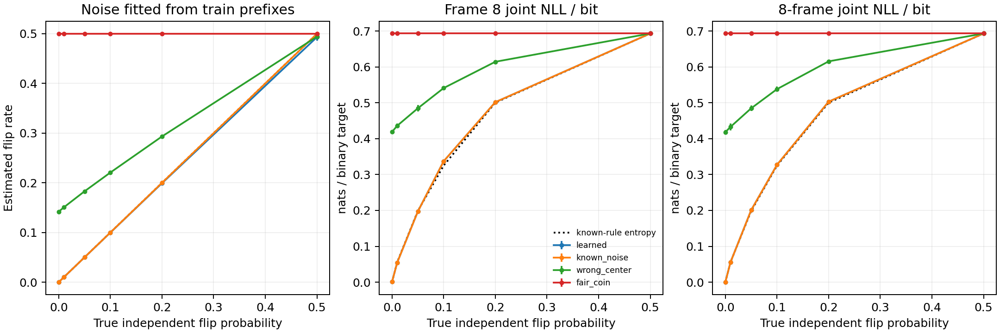

# Persistent latent rule inference under output noise

Reuse the three learned 18-class maps from PR #7, without refitting
or supplying analytic rule labels. Independent output flips occur after
every transition (including the observed history). This is the unfiltered
stochastic extension, NOT the original L3-SC or standard R0 architecture.

Fit one global epsilon per training corpus by marginal maximum likelihood
over independent uniform latent rule bits. Only 512 training histories
(8 frames each) are used. Evaluation uses 256 held-out-rule trajectories
per seed and noise setting. Rule bits are persistent across time. Each
future step updates the posterior only for teacher-forced scoring; for
autonomous sampling the model draws one rule table from the prefix posterior
and independently flips pixels at every predicted transition. Greedy rollout
uses a posterior mode table without injecting noise (not joint MAP over noisy
future trajectories). Joint NLL integrates each rule bit exactly once;
it is NOT independent pixel BCE. The independent marginal loss is separately
recorded. This posterior assumes independent rule bits rather than the exact
held-out-half prior, and uses a point estimate of epsilon.

Three seeds (42–44), six noise rates, four controls, 72 records.
The wrong-center control exchanges center and one corner bit before applying
the learned class map, and fits its own epsilon. No future frame is used to
fit either noise parameter or to generate the autonomous predictions.

|True p|Fitted p (mean)|Frame-8 joint NLL/target|8-frame joint NLL/target|Wrong-center frame-8 NLL|
|---:|---:|---:|---:|---:|
|0|0|.000860|.000557|.418867|
|.01|.010000|.054641|.055823|.435932|
|.05|.049967|.197069|.200827|.484685|
|.1|.099733|.337072|.327172|.541049|
|.2|.199167|.501763|.503183|.614318|
|.5|.493133|.693140|.693154|.693142|

At p=.1, the known-noise control yields .337052 first-frame NLL and
.327169 over eight frames, essentially identical to estimated noise.
Known-rule entropy is .325083 nats/target. At p=0 the unfiltered
greedy SeqAcc is 82.16%; at p=.01 it is .52%, and at higher rates no
exact eight-step greedy trajectories were observed. This is expected
under independent random outcomes; NLL and autonomous predictive samples
are more informative than single-realization exact accuracy. No certified
Structance or dense R0 result is implied.



Reproduce (from repository root):
```sh
PYTHONPATH=scripts python scripts/run_noisy_posterior.py --maps results/rule_hypotheses/merge_complete.jsonl --out /tmp/noisy_posterior.jsonl
python scripts/plot_noisy_posterior.py --input /tmp/noisy_posterior.jsonl --out /tmp/noisy_posterior.png
PYTHONPATH=.:scripts python -m pytest -q scripts/tests/test_noisy_posterior.py scripts/tests/test_rule_prior.py scripts/tests/test_rule_hypotheses.py
```

Original R0 GPU dispatch remains blocked: official A100 gateway doctor on
2026-11-24 reported zero registered releases; no unauthorized GPU usage.
