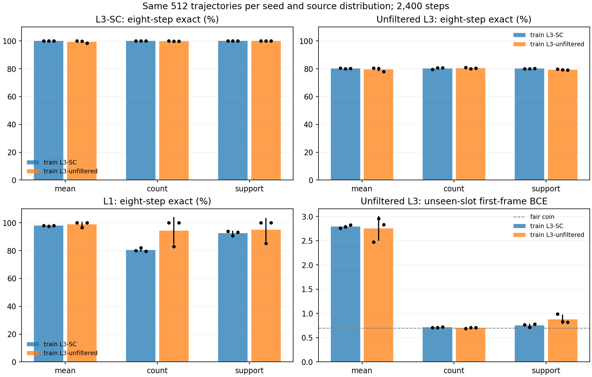

# Does uncertainty about unobserved CA rules transfer?

12 new independent CPU fits, 512 trajectories, seeds 42/43/44, 2400
Adam updates, batch 32. Existing six mean/count L3-SC runs reused from
the parent PR; same data hashes per distribution and seed. No retuning
on evaluation corpora. Full pinned L3-SC (2048), unfiltered L3 (2048)
and L1 (512) corpora; eight-step closed-loop exact sequence accuracy.
BCE is first-frame nats, not eight-frame accuracy or Structance.

New 300-parameter support arm divides signed learned-kernel evidence
by total matching support plus a trainable positive pseudo-count. An
empty evidence set yields the learned prior bias; increasing support
increases confidence for identical agreeing observations. It does not
receive the true rule or neighbor count. The three original models
are not changed. Compare training on original L3-SC against a distinct
unfiltered deterministic distribution sampled from the original train
half. True-slot coverage is used only for evaluation stratification.



| Training data | Model | L3-SC SeqAcc | Unfiltered L3 SeqAcc | L1 SeqAcc | Unseen-slot BCE on unfiltered L3 |
|---|---|---:|---:|---:|---:|
| L3-SC | mean |100%|80.26%|97.92%|2.791|
| L3-SC | count |100%|80.34%|80.53%|0.713|
| L3-SC | support |100%|80.16%|92.58%|0.754|
| Unfiltered L3 | mean |99.48%|79.52%|98.89%|2.752|
| Unfiltered L3 | count |99.95%|80.49%|94.34%|0.702|
| Unfiltered L3 | support |100%|79.44%|95.12%|0.880|

The mean model is severely overconfident on unobserved slots in
unfiltered L3; count is closer to the fair-coin BCE (ln 2 = .6931),
although the held-out rule split can correlate unknown bits. Neither
the new support variant nor unfiltered training materially improves
unfiltered L3 closed-loop accuracy at this budget. Support improves
SC-trained L1 transfer relative to count, not relative to mean.
Unfiltered training substantially improves average count-model L1
accuracy, but one seed is only 83.01% (others 100%). All support
models solve fully covered unfiltered L3; the remaining failure is
in the incomplete cohort (36.59–39.85% exact across the six fits).
Learned pseudo-counts are only .016–.028; this weakens shrinkage, so
the new variant is an experimental negative/partial result, not the
default. L1 is a different rule family; accuracy is not calibration.
No convergence or Structance claim, only one training M.

Reproduction (new output filename):
```sh
PYTHONPATH=scripts python -m unittest discover -s scripts/tests -p 'test_raw_evidence*.py'
PYTHONPATH=scripts python scripts/run_raw_evidence_calibration.py --corpora data/eval_corpora --out /tmp/calibration.jsonl
python scripts/plot_raw_evidence_calibration.py --new /tmp/calibration.jsonl --baseline results/raw_evidence_support/2400.jsonl --out /tmp/calibration.png
```
