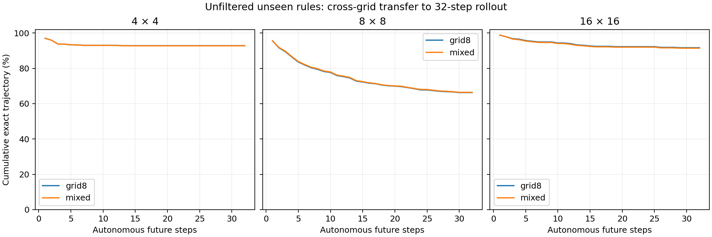

# Cross-grid and extended autonomous rollout

New 298-parameter raw neighborhood model evaluation, six independent fits
(three seeds x two training distributions), 1,200 updates, 512 trajectories
per fit. All models trained on the original self-consistency-filtered training
rule half. Grid8 uses 512 8x8 trajectories; mixed uses 128 4x4, 256 8x8,
128 16x16. Each trajectory has equal weight (mean BCE within same-grid
batches); mixed has more total target bits, so this is not matched-N or
matched-compute. No claim about Structance. New API accepts square grids >=3
and optional positive integer rollout horizon; default 8-step behavior
unchanged. No learned positional parameters or access to hidden rule counts.

| Grid | Released SC 8-step exact, 8-only / mixed | Unfiltered 32-step exact, 8-only / mixed | Fully covered count (out of 512) |
|---|---|---|---|
|4x4|100% / 100%|92.84% / 92.77%|453|
|8x8|100% / 100%|66.28% / 66.41%|261|
|16x16|100% / 100%|91.67% / 91.41%|419|

All six fits reach 100% exact 32-step rollout within fully covered cohorts
on all three sizes. Coverage is computed only after inference, from true
source frames; it is not a model input. Held-out unfiltered trajectories
are freshly sampled from the released ZS half with fixed master seed
2601125, simulated 39 transitions, and evaluated on frames 8..39; unlike
the SC corpora, they have no future-dependent filtering. Grid-specific
rules/initial samples are fixed across arms. Released SC corpus hashes
verified before use. SC BCE ranges around .0043 nats; long-horizon accuracy
does not measure likelihood. This is a structured control model, not R0.
The mixed-grid arm does not improve exact rollout materially at this budget.
Grid8-only transfer demonstrates spatial size generalization without
retraining; the missing-rule limitation remains. Not certified convergence.



Reproduce:
```sh
PYTHONPATH=scripts python -m unittest discover -s scripts/tests -p 'test_raw_evidence*.py'
PYTHONPATH=scripts python scripts/run_raw_evidence_grid.py --corpora data/eval_corpora --out /tmp/grid-transfer.jsonl
python scripts/plot_raw_evidence_grid.py --input /tmp/grid-transfer.jsonl --out /tmp/grid-transfer.png
```
