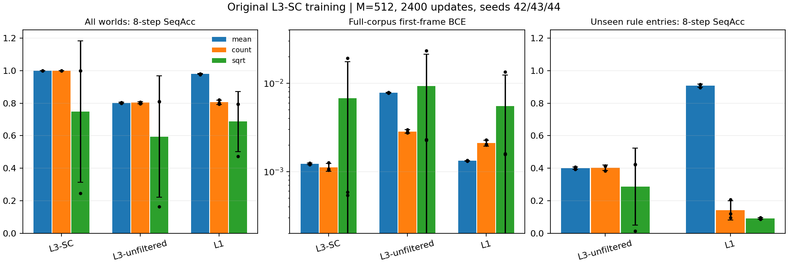

# Evidence normalization and incomplete rule coverage

This follow-up is a structured CA model comparison, **not R0** and
not a Structance measurement. The new 299-parameter sqrt arm divides
signed kernel evidence by the square root of its total support (clamped
to at least 1) before the learned confidence and noise-floor transform.
Mean (298 parameters) and count (299) are matched fresh controls.

Nine fresh CPU fits: same 512 fixed original L3-SC train trajectories per
seed, 2400 Adam updates, batch 32, 150 epochs, seeds 42/43/44. Identical
training hashes within seed; count arm reproduces prior 2400-step full
train BCE within 1e-8. No validation or L1 fine-tuning. The full released
L3-SC (2048), unfiltered L3 (2048), and L1 GoL (512) corpora are evaluated
using exact pinned SHA-256 files. All predictions use prefix only.
Full-corpus first-frame BCE is a different scope than the previous
256-world validation BCE.



| Arm | L3-SC SeqAcc | L3-unfiltered SeqAcc | L1 SeqAcc | L3-SC BCE |
|---|---:|---:|---:|---:|
| mean | 100% | 80.26% | 97.92% | 0.001225 |
| count | 100% | 80.34% | 80.53% | 0.001119 |
| sqrt | 74.87% | 59.44% | 68.68% | 0.006764 |

The new sqrt arm is **not recommended**: two seeds reached 100% L3-SC
SeqAcc with BCE around 0.00055; seed 43 reached only 24.61% and its
train BCE remained 0.01594. Do not average away the failed seed.
No training-budget/convergence claim.

## Where the earlier L1 loss comes from

For diagnosis only, use the simulator's true 18 outer-totalistic slots
to group trajectories by whether all slots encountered in the eight
ground-truth future transitions were present in the seven observed
transitions. This grouping sees true future frames, but neither
training nor inference receives it. Literal wrap-around indexing is
tested independently. Prefix-only model rollout is invariant to future
changes.

- L3-SC: 2048/2048 fully covered.
- L3-unfiltered: 1373/2048 fully covered, 675 incomplete.
- L1: 396/512 fully covered, 116 incomplete.

Mean and count both have 100% SeqAcc on every fully covered cohort and
100% first-frame accuracy on seen rule slots with unseen raw 3x3
patterns (32974 L3-SC, 37126 unfiltered L3, 4081 L1). Therefore the
learned rule equivalence generalizes beyond exact observed patterns.
On incomplete L1, mean reaches 90.80%, count only 14.08% SeqAcc.
On incomplete unfiltered L3, mean/count reach 40.10%/40.35%.
L1 advantage is distribution-specific, not a general unseen-rule solution.
With independent unknown rule bits, unobserved bits cannot generally
be determined from the prefix; report coverage-conditioned metrics and
uncertainty rather than claiming all unseen rules can be recovered.

Reproduce from root (fresh output path):
```sh
PYTHONPATH=scripts python -m unittest discover -s scripts/tests -p 'test_raw_evidence*.py'
PYTHONPATH=scripts python scripts/run_raw_evidence_support.py --corpora data/eval_corpora --out /tmp/ca-support.jsonl
python scripts/plot_raw_evidence_support.py --rows /tmp/ca-support.jsonl --out /tmp/ca-support.png
```
