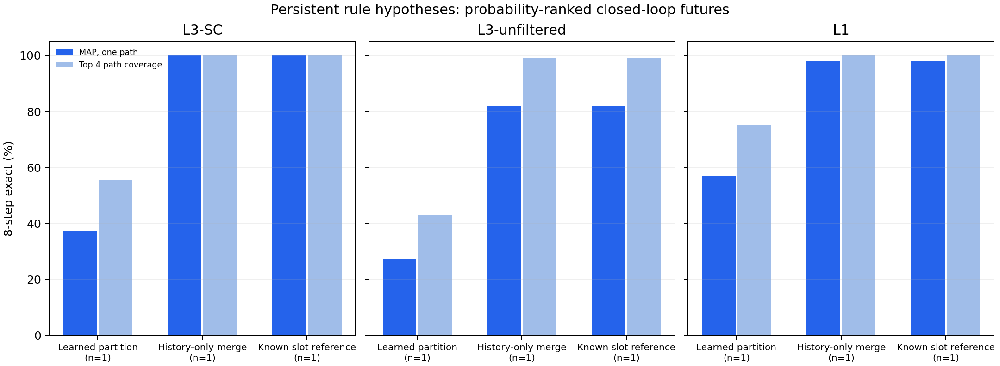

# Persistent rule hypotheses: partial experimental checkpoint

A deterministic next-frame predictor commits to a single completion of
unknown rules. Here a priority queue instead branches only when a previously
unseen rule class is queried. Each missing bit is sampled once per world,
and its assignment persists during the entire closed-loop forecast.
Under independent uniform missing-bit priors, a completed path involving k
new bits has mass 2^-k; best-first search ranks distinct complete futures
by this mass. Top-4 coverage is a separate metric, NOT one-trajectory SeqAcc.
A bounded search explicitly reports exhausted jobs and prefix contradictions;
a missing returned path is counted as a miss. This is a diagnostic prior
over the full rule space; it does not use held-out split membership, known
Game-of-Life parameters, or original SC future selection in decoding.

## Verified first-seed checkpoint (42; not yet three-seed aggregate)

The 298-parameter raw-neighborhood encoder is trained on 512 original
L3-SC train trajectories for 1,200 updates, with the original first-frame
BCE plus a masked-history reconstruction auxiliary term of weight 0.5.
The latter excludes the target transition's source/outcome evidence from
the evidence table, but other history observations may be after that
transition. It is a training-only denoising objective, not online causal
prediction of that historical frame. Future frames never enter inference.
Threshold .5 on learned affinity gives 49 connected components, not the
true 18. No false merges (0 ordered pairs); 5,548 false splits. The greedy
soft model has 99.95% SC SeqAcc, but hard-discretization fails.

A separate training-only merge repairs the partition. Repeated co-observation
in at least 12 train trajectories with zero conflicting outcomes is required;
after each merge check against the merged evidence again. This recovered
exactly 18 classes (zero false splits or merges versus the analytic reference)
for seed 42, without giving the learning code neighbor counts or rule IDs.
Analytic equality is evaluated after learning only. The reference explicitly
receives outer-totalistic classes. Both are separate from the R0 main model.

| Predictor | SC MAP / top4 | Unfiltered MAP / top4 | L1 MAP / top4 |
|---|---|---|---|
| Learned partition before repair |37.45 / 55.66%|27.25 / 43.02%|56.84 / 75.20%|
| History-only repair, seed 42 |100 / 100%|81.88 / 99.12%|97.85 / 100%|
| Known-class reference |100 / 100%|81.88 / 99.07%|97.85 / 100%|

The two equivalent partitions can choose different tied paths (their class
IDs determine heap tie order). The 99% top4 result is not an improvement
of single-path accuracy and cannot be compared directly to a greedy model.
On L1, filling all unseen bits with zero gives 100% in this corpus;
uniform missing-bit MAP is not the correct L1-specific prior.
The full corpus files and their hashes are inherited from the released
validation protocol. Three seeds were requested in the run; this snapshot
includes only completed records, and will not be interpreted as a
three-seed result. No claim of Structance or convergence.



## Reproduce
```sh
PYTHONPATH=scripts python scripts/run_rule_hypotheses.py --corpora data/eval_corpora --out /tmp/hypotheses.jsonl
PYTHONPATH=scripts python scripts/run_rule_hypotheses_merge.py --input /tmp/hypotheses.jsonl --corpora data/eval_corpora --out /tmp/hypotheses-merge.jsonl
python scripts/plot_rule_hypotheses.py --inputs /tmp/hypotheses.jsonl /tmp/hypotheses-merge.jsonl --out /tmp/hypotheses.png
PYTHONPATH=.:scripts python -m pytest -q scripts/tests/test_rule_hypotheses.py scripts/tests/test_raw_evidence*.py scripts/tests/test_art_tokenizer.py scripts/tests/test_e14_torus_rope.py scripts/tests/test_e15_pair_controls.py scripts/tests/test_eval_tf.py
```
